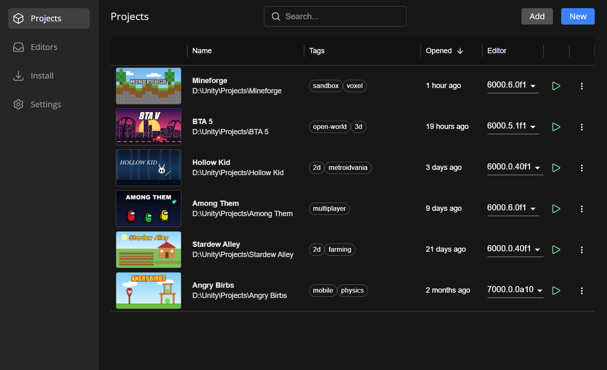
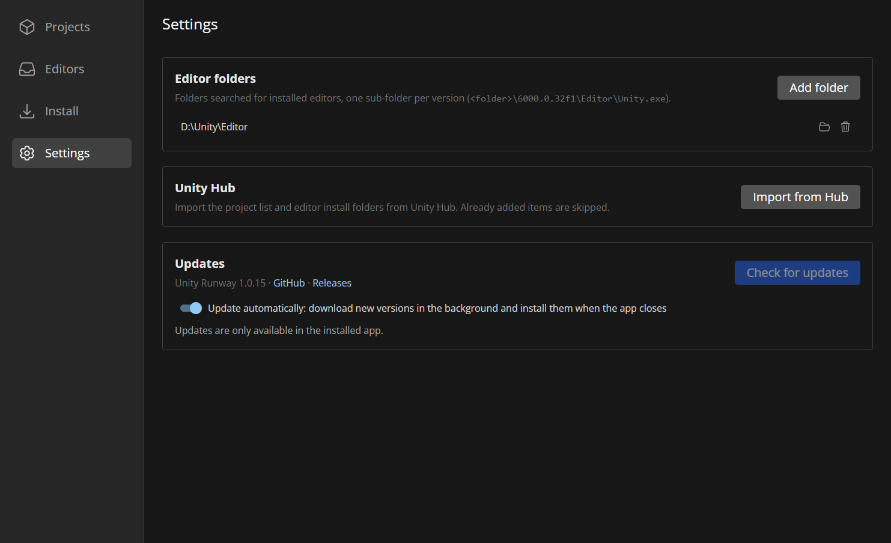

<h1 align="center">Unity Runway</h1>

A lightweight project launcher for Windows, compatible with Unity software, as an alternative to Unity Hub. Keep all your Unity projects in one list, open each with the right editor, install editors and modules without signing in to the Hub, and create new projects from the editors' templates.

## Features

- **Projects** - previews, tags, search by name or tag, sorting by the last opened date. Pick the editor for a project; Runway warns before a project is upgraded or downgraded to another Unity version
- **New project** - choose the editor version, a template shipped with it (3D URP, Universal 2D, HDRP...) or an empty project, the name and the folder
- **Rename** - renames the project folder together with its solution files
- **Install editors** - browse LTS, Supported, Tech, Beta and Alpha releases and install an editor with the modules you need (platforms, language packs, documentation) straight from Unity's servers, with a single administrator prompt
- **Editors** - all installed editors from every editor folder in one list, with their modules:
  - **Update** to the latest patch of the same version line; the old patch is removed and its projects switch to the new one
  - **Install the latest** version from a newer line next to the current one
  - add modules, show in Explorer, uninstall
- **Unity Hub import** - pick up the project list and editor folders from Unity Hub in one click
- **Updates** - new versions of Runway are downloaded in the background and installed when you close the app; can be turned off to check by hand

## Install

Download the installer (`UnityRunway-Setup-<version>.exe`) from the [Releases](../../releases) page and run it. Then:

1. In **Settings**, add the folders with your Unity editors (for example `C:\Program Files\Unity\Hub\Editor`), or press **Import from Hub**.
2. In **Projects**, press **Add** to add existing projects or **New** to create one.

To show a preview of a project in the list, put a `preview.png` or `preview.jpg` into the project folder.

Make a backup or commit your project to version control before renaming it or opening it with another Unity version. Use the program at your own risk.

## License

This project is licensed under the [GPL-3.0](LICENSE).
